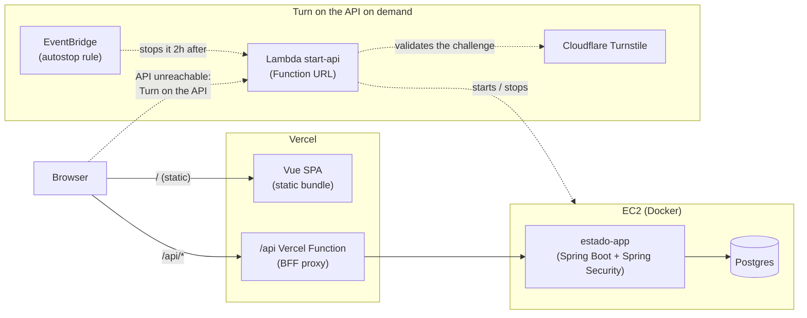
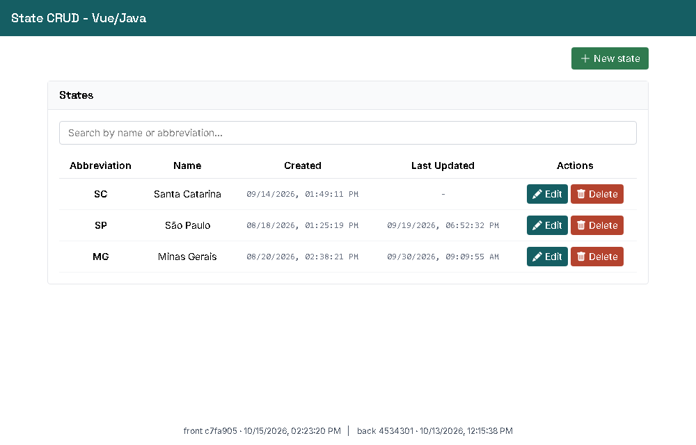
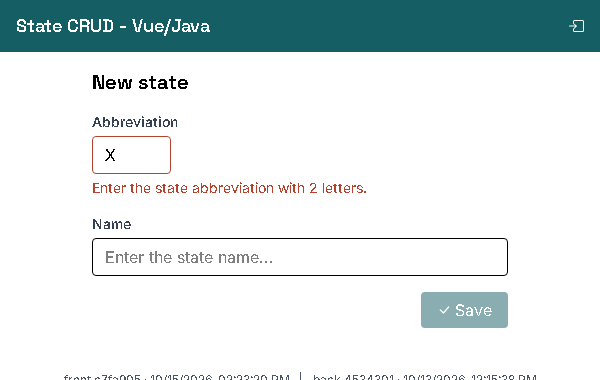

# vue_state

[](https://github.com/ronybrand/vue_state/actions/workflows/ci.yml)
[](https://github.com/ronybrand/vue_state/actions/workflows/codeql.yml)

**[Live application](https://vue-state.vercel.app/)**

CRUD for Brazilian federative units (states): abbreviation, name and created/updated timestamps.
It consumes the [Estado project](https://github.com/ronybrand/estado)'s REST API at `/api/estado`.
This is the **Vue 3** frontend for that backend, a port of the Next.js `react_state` frontend (and
a sibling of the Angular one).

## Architecture



The browser never talks to the backend's own origin. `api/proxy.ts` (logic in `server/proxy.ts`)
forwards `/api/*` to `BACKEND_API_URL` server-side, so neither CORS on the backend nor a CSP
`connect-src` naming it is needed. In development, Vite's own proxy plays that role.
`POST /auth/login` returns a short-lived JWT, kept in `localStorage` and attached as
`Authorization: Bearer <token>` by an axios interceptor. Listing and reading states stays public,
matching the backend's own authorization rule; only create and edit require a token.

## Screenshots




## Stack

- [Vue 3](https://vuejs.org/) (Composition API, `<script setup>`) + TypeScript strict + [Vite](https://vite.dev/)
- [Vue Router](https://router.vuejs.org/): lazy routes and a `beforeEach` auth guard
- [TanStack Vue Query](https://tanstack.com/query/latest/docs/framework/vue/overview): fetching, caching, invalidation
- [Axios](https://axios-http.com/) with request-id and timeout/retry interceptors
- [Zod](https://zod.dev/) for validation and domain types
- [Tailwind CSS](https://tailwindcss.com/) v4
- [Vitest](https://vitest.dev/) + Testing Library for Vue, [Playwright](https://playwright.dev/) + axe-core
- ESLint (`eslint-plugin-vue` + `typescript-eslint`) + Prettier + Husky/lint-staged

## Structure

```
src/
├── main.ts, App.vue         # bootstrap (router, Vue Query, 401 subscriber) and app shell
├── router/                   # routes + auth guard (meta.requiresAuth)
├── views/                    # StateListView, AskAiView, StateCreateView, StateEditView, LoginView, NotFoundView
├── components/               # StateForm, ConfirmDialog (native <dialog>), FormPage, ErrorMessage,
│                               AppFooter, BaseIcon, BaseSpinner
├── composables/              # useStateQueries (Vue Query), useErrorMessage, useTokenValid,
│                               useDebouncedValue, useLogin, useBuildInfo
├── lib/                      # httpClient (axios + interceptors), tokenStorage, sessionExpired,
│                               extractRequestId, formatDate, uuid
├── interfaces/               # State / NewState (zod) / FrontendVersion / BackendInfo
└── services/                 # stateService + stateApiMapper (wire <-> domain), aiAgentService, authService, infoService

server/proxy.ts               # the BFF proxy (spec next to it)
api/proxy.ts                  # Vercel Function entry point (re-export; everything in api/ deploys)
e2e/                          # Playwright specs and API fixtures
scripts/generate-version.mjs  # writes public/version.json (commit + build date) for the footer
```

### React to Vue mapping

| React / Next.js                        | Vue                                                    |
| -------------------------------------- | ------------------------------------------------------ |
| `hooks/useX` (React Query)             | `composables/useStateQueries.ts` (Vue Query)           |
| `useErrorMessage` (useState)           | `composables/useErrorMessage.ts` (refs)                |
| `useTokenValid` (useSyncExternalStore) | `composables/useTokenValid.ts` (ref + scope cleanup)   |
| `ProtectedRoute` + `(protected)` group | `meta.requiresAuth` + `router.beforeEach`              |
| react-hook-form + zodResolver          | `StateForm.vue` with `zod.safeParse` on reactive data  |
| `ConfirmDialog` forwardRef             | `ConfirmDialog.vue` with `defineExpose({ open })`      |
| `app/api/[...path]/route.ts` (BFF)     | `server/proxy.ts` via `api/proxy.ts` + Vite dev proxy  |
| `proxy.ts` per-request CSP nonce       | static CSP in `vercel.json` (no inline scripts in SPA) |

### Conventions

- Composition API only, typed `defineProps`/`defineEmits` (camelCase emits), `useTemplateRef`,
  keyed `v-for`, multi-word component names and `Base*` prefix for generic ones, composables
  named `useX` and returning refs.
- Data cache via Vue Query: every mutation invalidates the `['states']` key. The list uses
  `keepPreviousData`, so changing the search or sort keeps the table on screen instead of flashing
  the spinner.
- `httpClient` centralizes a 15s timeout and retry (up to 2 attempts, GET only). The
  `X-Request-Id` is generated once per action and kept across retries, so all attempts correlate
  as a single action in the backend logs. A 401 clears the token and notifies a subscriber
  (`lib/sessionExpired.ts`) that `main.ts` wires to the router; `httpClient` cannot import the
  router itself because views import services, which import `httpClient`.
- The public `/ask` page sends questions to the same-origin `/api/ask` BFF route. The proxy only
  allows the backend paths the app needs, keeps the AI provider credentials server-side, and gives
  this slower tool-calling request a 55s backend timeout (60s at the browser and Vercel function).
  AI output is displayed as text rather than injected HTML.
- The backend's JSON contract uses Portuguese field names (`sigla`, `nome`, ...) and the path
  segment `/estado`. Those are the real wire contract and are **not** translated;
  `services/stateApiMapper.ts` is a small anti-corruption layer mapping them to the English
  `State` type, so the rest of the app never sees them.
- Accessibility: `aria-invalid`/`aria-describedby` on form fields, dynamic `aria-label` on row
  actions, `role="status"`/`role="alert"` for loading/error states, `aria-sort` on sortable
  headers. axe-core (WCAG 2.1 A/AA) runs over every screen in the e2e suite.
- `stateService.list` fetches the whole dataset in one request: the domain is closed at 27 items,
  so real pagination never triggers. The backend only exposes `/estado/paginado`, which the
  frontend still consumes without surfacing paging in the UI.
- No async side effects (queues, notifications) exist in this frontend. Everything is a
  synchronous request/response, so there is nothing to move off the request path.

### When the API is turned off

To save cost, the backend instance is stopped while the project isn't in use. When the API doesn't
answer (no response, timeout or 502/503/504), the error message says so and offers a **Turn on the
API** link. It opens a page served by the backend's `start-api` Lambda (anti-bot challenge, starts the
instance, waits for the API to come back; the instance stops by itself after 2 hours), see
[ADR 0026](https://github.com/ronybrand/estado/blob/master/docs/adr/0026-ligar-api-sob-demanda.md). Implemented in `src/lib/apiErrorMessage.ts`.

## Development

Requires the State API backend. By default Vite proxies `/api` to `http://localhost:8080`.

```bash
npm install
BACKEND_API_URL=http://localhost:8090 npm run dev   # point at another backend if needed
```

### Environment variables

`BACKEND_API_URL`: server-side only, the backend base URL the proxy forwards to. Required in
production (the proxy answers 500 if it is missing); defaults to `http://localhost:8080` outside
production. Deliberately **not** a `VITE_` variable: Vite inlines those into the client bundle,
which would make the browser call the backend directly and bypass the proxy.

`BACKEND_PROXY_SECRET`: server-side only, optional. A shared secret that lets the backend trust
the client IP this app forwards (`X-Client-IP`, taken from Vercel's `x-vercel-forwarded-for`).
Without it the backend only sees Vercel's egress IPs, so its per-IP rate limits (including the
login limit) are shared by every visitor. It must match the backend's `RATE_LIMIT_PROXY_SECRET`.

## Scripts

```bash
npm run lint           # eslint
npm run typecheck      # vue-tsc
npm run format:check   # prettier --check
npm run test           # Vitest unit/component tests
npm run test:coverage  # with v8 coverage
npm run build          # type-check + production build to dist/
npm run e2e            # Playwright + axe-core against the production build (mocked API)
```

Husky + lint-staged run `eslint --fix` and `prettier --write` on pre-commit. The e2e suite serves
the production build with `vite preview`, so run `npm run build` once first. Every `/api` call is
mocked, so no backend is needed.

## Deployment

Live at **[vue-state.vercel.app](https://vue-state.vercel.app/)**, deployed on Vercel as a Vite
app. `vercel.json` carries the SPA rewrite, the `/api/:path*` rewrite to the proxy function and the
security headers. Set `BACKEND_API_URL` (and optionally `BACKEND_PROXY_SECRET`) in the project's
environment variables, then run `npx vercel --prod` from a Vercel-linked checkout.

The function's relative imports carry a `.js` extension because the package is ESM and Node
resolves them at runtime without a bundler.

## Security

See [SECURITY.md](SECURITY.md) for the reporting policy and what the project already does.

## Development process

Built test-first (red, green, refactor): the specs for each layer were written and run failing
before the code they cover.
